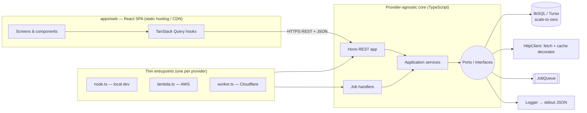
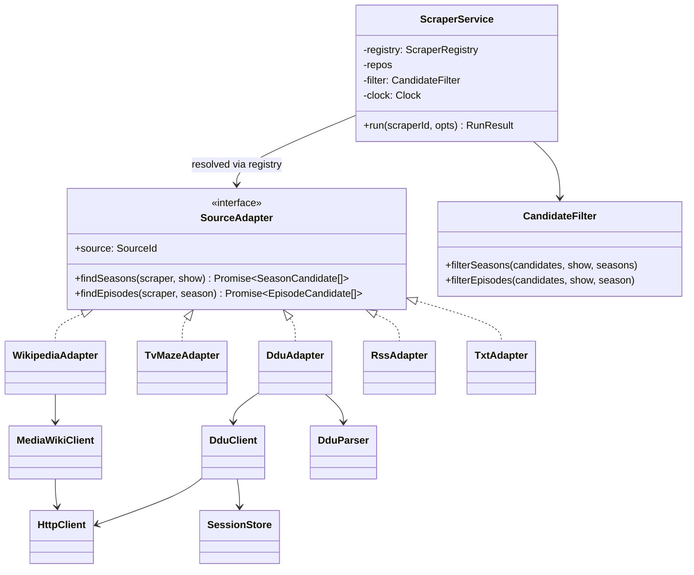
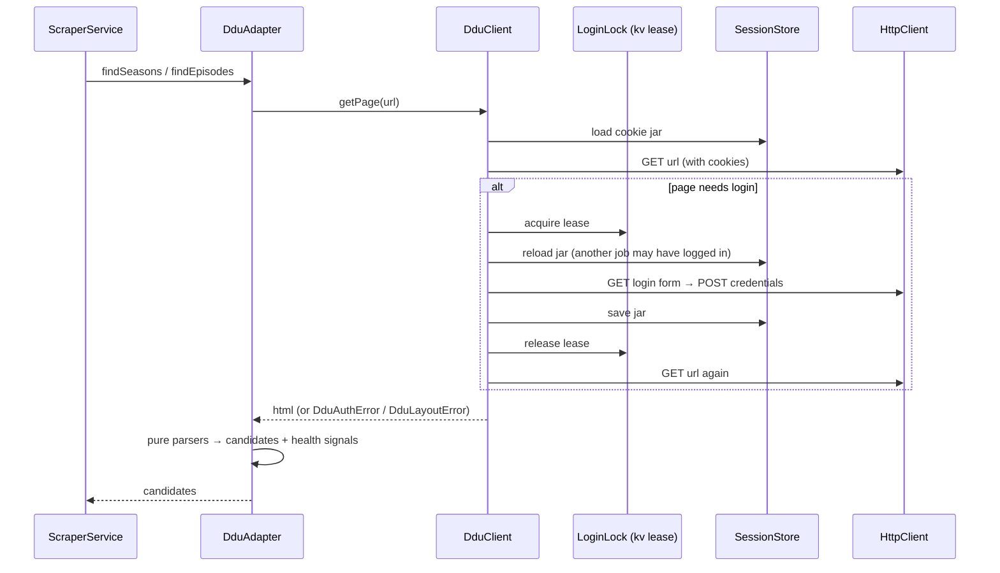
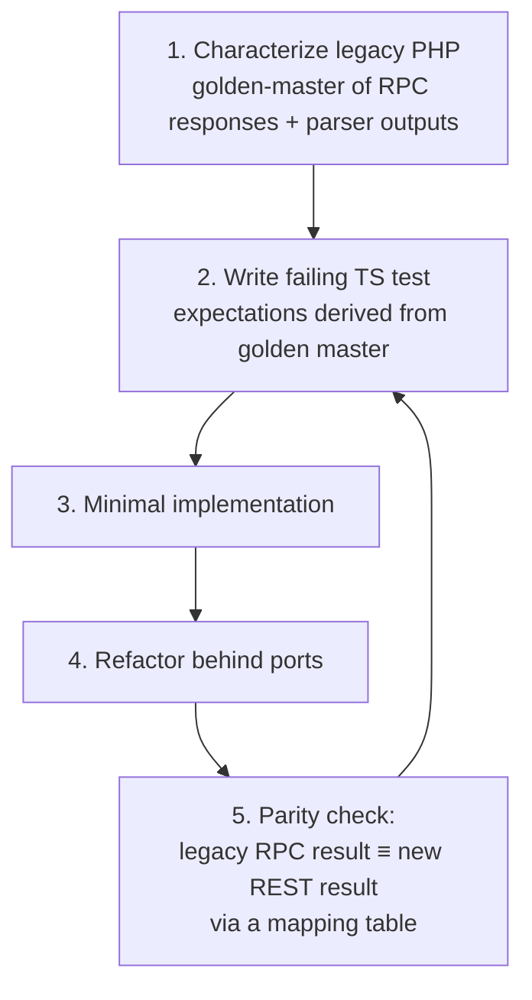

# TVScraper Migration Plan

**From:** PHP API + jQuery/Bootstrap 3 frontend, SQLite file, bash jobs
**To:** Node.js (TypeScript) + React, TDD-first, interface-based design with dependency injection, serverless and scale-to-zero, cloud-agnostic

## 0. Decisions

| # | Topic | Decision |
|---|---|---|
| 1 | Cloud target | **Kept open.** The code must run unchanged on AWS Lambda, Cloudflare Workers or plain Node. Provider-specific code is limited to thin entrypoints and adapters. |
| 2 | Infrastructure | **Must scale to zero.** No always-on servers, containers or provisioned databases. |
| 3 | Sources | **TVRage and TV Underground are dropped.** Their scrapers are not ported, and existing DB rows for them are removed during data migration. Wikipedia, TVMaze, RSS and TXT are ported. **DDU is foundational and must work at all times.** It is the critical path of the migration (§4). |
| 4 | API style | **REST.** The `action=` RPC endpoint is not carried over (see §8 for the transition). |
| 5 | Auth | **Single user.** |

---

## 1. Current state

| Area | Today | Implication |
|---|---|---|
| API | `api.php`: a single RPC endpoint (`POST action=…`) with about 35 methods, most of them passing straight through to the DB class. `runScraper` instantiates scrapers through a `switch` with `new`. | The method table defines the feature scope. The `switch` becomes a registry. |
| Persistence | `TVShowScraperDBSQLite.php` is the current backend. `TVShowScraperDB.php` is the legacy XML backend, still used by `TVScraper.php` and `migrate.php`. Core logic sits in **SQL views** that use `strftime('now')` (`bestScrapersFiles`, `tvShowsWithStats`, `seasonStats*`). | The XML backend is dropped. Time-dependent logic must take an injected clock. |
| Scrapers | `abstract TVShowScraper` with 7 subclasses. `TVU extends RSS`. Each subclass calls `new SimpleBrowser()` / `new DDUBrowser()` / `new DDUParser()` internally. | This is the main refactoring target: inheritance and hidden `new` calls are replaced by injected interfaces. |
| HTTP | `SimpleBrowser` keeps its config in **static** globals and stores cache and cookies on the **filesystem**. `DDUBrowser extends SimpleBrowser` and adds login. `MyCurl` shells out to `curl`. | Static config and local disk both break serverless and make testing hard. |
| Cross-cutting | `setLogger`/`log`/`error` is copy-pasted into about 8 classes. Errors are returned as `FALSE`. | One injected `Logger` and typed errors replace them. |
| Concurrency | `flock` on a file. | DB transactions replace it. |
| Frontend | `index.html` plus jQuery "classes" (`TVShow.js`, `Season.js`, `Scraper.js`, …) that clone DOM skeletons. | Rewritten in React. |
| Jobs / CLI | `tvjobs` / `tvshell` are bash scripts that call the HTTP API. | Replaced by scheduled functions and a Node CLI. |
| Auth | Delegated to web-server HTTP digest auth. | The app needs its own auth. |
| Tests | None. | Characterization tests come first. |

---

## 2. Target architecture



### Scale-to-zero stack (provider-agnostic)

| Concern | Choice | Why |
|---|---|---|
| Compute | Functions: Lambda **or** Workers **or** Node | All bill per request and scale to zero. Hono runs on all three. |
| Database | **libSQL (Turso)** via `@libsql/client` + Drizzle ORM | Serverless, scales to zero, reached over HTTP so it works from Lambda and Workers. It keeps the **SQLite dialect**, so the existing schema and views port with minimal change. Local dev and tests use an in-memory or file libSQL, the same engine as production, which keeps the TDD loop fast. Neon Postgres is the fallback if needed; repositories hide the choice. |
| HTTP cache & DDU session | A `kv` table in the same DB (`key`, `value`, `expiresAt`) behind the `Cache` / `SessionStore` ports | Adds no extra service and scales to zero. It can be swapped later for Upstash Redis or Cloudflare KV. |
| Job fan-out | `JobQueue` port. Adapters: SQS (AWS), Cloudflare Queues, in-process (local/tests) | Both cloud queues scale to zero. |
| Scheduling | EventBridge Scheduler / Cloudflare Cron Triggers, both calling the same `scheduled` handler | Configured per provider; the handler code is shared. |
| Frontend hosting | Any static host (S3 + CloudFront, Cloudflare Pages, …) | Static hosting has no idle cost. |
| Secrets & config | Env vars validated with zod in one `loadConfig()` | Works with every provider's secret mechanism. |
| Logs | pino JSON to stdout | Every provider collects stdout. |

### Monorepo layout (pnpm workspaces)

```
packages/
  domain/      pure TS: entities, best-file selection, season/episode rules — no I/O
  scrapers/    SourceAdapters + pure parsers (Wikipedia, TVMaze, DDU, RSS, TXT)
  ports/       interfaces only
  adapters/    implementations: fetch HttpClient, Drizzle repos, KV cache, queues
  contracts/   zod schemas + OpenAPI for the REST API (shared by api, web, cli)
apps/
  api/         Hono app, services wiring (composition root), entrypoints/{node,lambda,worker}.ts
  web/         React + Vite
  cli/         replaces tvshell / tvjobs (talks REST)
legacy/        current PHP, kept read-only as the reference until cut-over
doc/
```

---

## 3. Refactoring: subclasses → interfaces + dependency injection

### Ports

```ts
interface HttpClient    { get(url: string, opts?: { useCache?: boolean }): Promise<string>;
                          post(url: string, form: Record<string, string>): Promise<string>; }
interface Cache         { get(key: string): Promise<string | null>;
                          set(key: string, value: string, ttlSec: number): Promise<void>; }
interface SessionStore  { load(name: string): Promise<CookieJar>; save(name: string, jar: CookieJar): Promise<void>; }
interface JobQueue      { enqueue(job: Job): Promise<void>; }
interface Clock         { now(): Date; }
interface Logger        { debug(msg: string, ctx?: object): void; info(...): void; error(...): void; }

interface ShowRepository, SeasonRepository, EpisodeRepository,
          FileRepository, ScraperRepository, ScrapedSeasonRepository
```

### Scrapers: composition instead of inheritance



Rules:

1. **The base class's workflow becomes a service.** `runScraper`, `submitSeasonCandidates` and `submitEpisodeCandidates` move into `ScraperService` + `CandidateFilter`. Adapters only *fetch and parse*. They never touch the DB, so the `$showOnlyNew` / `$saveResults` flags no longer go through every adapter.
2. **Parsers are pure functions**, for example `parseDduTopicList(html, baseUrl)`, `parseWikipediaEpisodes(wikitext)` and `parseTvMazeEpisodes(json)`. They are the easiest code to test and the most fragile.
3. **`DDUBrowser extends SimpleBrowser` becomes a `DduClient` that wraps an `HttpClient`**, with the login flow and cookies persisted through `SessionStore`.
4. **Caching is a decorator**: `new CachingHttpClient(inner, cache, clock)`. No static flags remain.
5. **The `switch` becomes a `ScraperRegistry`** (`Map<SourceId, SourceAdapter>`), built in a **composition root** per entrypoint. DI is plain constructor injection with no framework, which keeps cold starts small.
6. **Time-dependent SQL views become repository queries that take `now`** from `Clock`. Best-file selection (`getBestFileForEpisode` + `bestScrapersFiles`) becomes a **pure domain function**, because it is the core business rule.
7. **Errors are typed** (`NotFoundError`, `ValidationError`, `SourceFetchError`, …) and mapped to HTTP status codes in a single place.
8. **One `Logger` is injected** instead of the copy-pasted `setLogger`/`log`.

---

## 4. DDU: the critical path

DDU is the source the app exists for. The plan therefore treats it differently from the other sources:

- **It is de-risked first.** Live connectivity from each candidate runtime is proven in phase 0, before any architectural commitment.
- **It is ported first.** It is the first adapter in phase 4, not the last.
- **It has its own exit gate.** No cut-over happens until DDU shadow runs match legacy (§8, phase 8).
- **It can run anywhere.** Its jobs can run in the cloud or on a home runner without code changes.

### 4.1 Behaviour to preserve (from `DDUBrowser.php`, `DDUParser.php`, `TVShowScraperDDU.php`)

| Behaviour | Legacy detail |
|---|---|
| Login detection | The page needs login if `div#page-header` contains `a[title="Login"]`. |
| Login flow | `GET https://ddunlimited.net/ucp.php?mode=login`. Collect **all** `hidden`/`submit` inputs of `form#login`; inputs that share a name become arrays. Add username and password, then `POST` to the same URL. Success means the response no longer needs login. |
| Re-auth on any page | On every `get`: if login is needed, invalidate the cache for that URL, log in, fetch again. If the page still needs login, it is a hard error. |
| Session & cache scoping | Cookies and cache are **per user** (keyed by `md5(username)`). |
| Show scraper | Board URL + `&start=0,25,50,75` (4 pages). Topic list from `div.forumbg ul.topics > li`. Sticky/announcement topics are filtered out and topics are sorted by pubDate. Titles are matched with `"<title> - stagione N"` against title and alternate title (6 regex variants). The description tags are parsed for resolution (`720p/1080i/1080p` else `sd`) and audio/sub languages. |
| Season scraper | Topic URL. Every `href="ed2k://…"` in the page becomes an episode candidate with `pubDate = now` (now comes from `Clock` in the port). |
| Sanity warnings | "no topics in DIV", "no regular topics", "latest topic older than 30 days", "no ed2k links". In the new code these become **health signals** instead of log lines. |

### 4.2 Design



- **Pure parsers**: `parseLoginForm`, `needsLogin`, `parseBoardTopics`, `matchShowTitle`, `parseTopicTags`, `extractEd2kLinks`. The PHP builds regexes from the show title with incomplete escaping; the port uses proper regex escaping, plus table-driven tests built from real titles.
- **`DduClient`**: cookie jar with `tough-cookie`, serialized into `SessionStore`. Credentials come from secrets and never from the DB or logs.
- **Single-flight login**: queue fan-out could otherwise trigger many logins at once and risk an account lock. A lease row in the `kv` table serializes logins, and the jar is reloaded after the lease is acquired.
- **Throttling**: DDU jobs run with **concurrency 1** on a dedicated queue, with a configurable delay between requests. Cache TTL is respected as in legacy.
- **Typed failures**: `DduAuthError` (bad credentials or login still required after re-auth), `DduLayoutError` (markup changed), `DduBlockedError` (403, challenge page, captcha). Errors are no longer swallowed as `FALSE`.

### 4.3 Placement: cloud or home runner

DDU may block datacenter IPs or sit behind an anti-bot layer. The design makes this a **deployment choice, not a code change**:

- DDU jobs are routed to a dedicated `ddu` queue (source-affinity routing in `JobQueue`).
- That queue is consumed by **either** the cloud function **or** a **home runner**: the same `apps/api` job handler started with the Node entrypoint on any always-available machine (NAS, Raspberry Pi…). It polls outbound only, so it works behind NAT, needs no open ports, and leaves the cloud side scaling to zero.
- Phase 0 decides the default placement from live tests: Lambda egress, Workers egress (Workers `fetch` to a Cloudflare-protected origin behaves differently) and residential IP.

### 4.4 Tests (TDD)

| Level | Cases |
|---|---|
| Parser unit (fixtures) | board page with sticky + announcement + regular topics; topic page with ed2k links (incl. none); login page with duplicate-name hidden inputs; logged-out page; login-failure page; blocked/challenge page |
| Title matching (table-driven) | title, alternate title, `Title (Foo)`, `Foo (Title)`, punctuation stripping, regex-special characters in titles, zero-padded season numbers |
| Tag parsing (table-driven) | SD/720p/1080i/1080p, multiple audio languages, `SUB` languages, short or malformed tag lists |
| `DduClient` (fakes) | valid session; expired session mid-pagination; login success; wrong password; still-needs-login after login; concurrent jobs share one login; 403/challenge → `DduBlockedError` |
| Parity | legacy `runScraper` vs new adapter on the same fixtures and fixed clock: identical candidates |
| Live (nightly, real account) | login + one board page + one topic page from **each configured placement** |

### 4.5 Monitoring and alerting

- Every run records `{source, scraperId, status, error, warnings, durationMs}` in a `scraper_runs` table.
- `GET /health/sources` reports the last success and current status per source.
- A `Notifier` port (e.g. email or Telegram adapter) **alerts immediately** on `DduAuthError` / `DduBlockedError`, and when DDU has had no successful run within a configurable window (default 24 h). Layout sanity warnings are alerted at most once per day.

---

## 5. REST API design

Resources replace the RPC methods of `api.php`. Request and response schemas live in `packages/contracts` (zod), and an OpenAPI document is generated from them.

| Legacy RPC method(s) | REST |
|---|---|
| `getAllTVShows`, `addTVShow` | `GET /shows` (with stats), `POST /shows` |
| `getTVShow`, `setTVShow`, `removeTVShow` | `GET / PATCH / DELETE /shows/{id}` |
| `getTVShowSeasons`, `addSeason` | `GET / POST /shows/{id}/seasons` |
| `getSeason`, `setSeason`, `removeSeason` | `GET / PATCH / DELETE /seasons/{id}` |
| `getAllWatchedSeasons` | `GET /seasons?status=watched` |
| `getSeasonEpisodes` | `GET /seasons/{id}/episodes` |
| `getEpisode`, `setEpisode`, `removeEpisode` | `GET / PATCH / DELETE /episodes/{id}` |
| `getFilesForEpisode` | `GET /episodes/{id}/files` |
| `getFile`, `setFile`, `removeFile` | `GET / PATCH / DELETE /files/{id}` |
| `getBestFileForEpisode` | `GET /episodes/{id}/best-file` |
| `getBestFilesForSeason` | `GET /seasons/{id}/best-files` |
| `TVScraper.php?action=latest`, `tvjobs get-best` | `GET /best-files?type=ed2k\|torrent&since=…&limit=…` |
| `tvjobs find-missing` | `GET /episodes?missing=true&airedBefore=…` |
| `getTVShowScrapers`, `addScraper` (show) | `GET / POST /shows/{id}/scrapers` |
| `getSeasonScrapers`, `addScraper` (season) | `GET / POST /seasons/{id}/scrapers` |
| `getScraper`, `setScraper`, `removeScraper` | `GET / PATCH / DELETE /scrapers/{id}` |
| `getActiveScrapers` | `GET /scrapers?active=true` |
| `runScraper` | `POST /scrapers/{id}/runs` (sync, single scraper) |
| `tvjobs update` | `POST /scraper-runs` (enqueues all active scrapers, returns `202`) |
| `getScrapedSeasons` | `GET /shows/{id}/scraped-seasons` |
| `getScrapedSeasonsTBN` | `GET /scraped-seasons?status=pending` |
| `setScrapedSeason`, `removeScrapedSeason` | `PATCH / DELETE /scraped-seasons/{id}` |
| `createSeasonScraperFromScraped` | `POST /scraped-seasons/{id}/accept` |
| *(auth)* | `POST /session`, `DELETE /session` |

**Semantics fix.** In the legacy code, `getBestFilesForSeason` and `getBestFileForEpisode` are flagged `save => TRUE`: a read has the side effect of updating the cached `bestFile`. In REST, `GET` must have no side effects. The best file is therefore recomputed **on write** (after a scraper run, or when a file is discarded or edited) inside the same transaction. `GET` stays a pure read.

Conventions: JSON only; `PATCH` takes partial bodies validated by zod; errors use RFC 9457 `application/problem+json`; ids are integers (preserving existing data); timestamps are ISO-8601 in the API and epoch seconds in the DB, as today.

---

## 6. Single-user auth

- One credential: `ADMIN_PASSWORD_HASH` (argon2/bcrypt) in env.
- `POST /session` with the password returns an **HttpOnly, Secure, SameSite=Strict** cookie holding a short-lived signed JWT (`SESSION_SECRET`). Being stateless, it needs no session store.
- The CLI and cron callers use a static **API token** (`API_TOKEN`) sent as `Authorization: Bearer …`.
- Hono middleware protects everything except `POST /session` and the health check.
- There are no user tables and no external identity provider. If multi-user is ever needed, the auth middleware is the only place that changes.

---

## 7. TDD strategy



Because the API moves from RPC to REST, parity is checked **at the service level**. The parity harness calls the legacy `action=X` and the equivalent REST route on the same seeded DB copy, normalizes both payloads, and diffs them. The table in §5 doubles as the harness's mapping.

| Layer | Tools | Scope |
|---|---|---|
| Domain (pure) | Vitest | best-file selection, complete-season cutoff, resolution check, ED2K and filename parsing (`TVShowUtils.php`) |
| Parsers | Vitest + **recorded fixtures** (`__fixtures__/*.html\|json`) | One fixture set per source, captured from real pages. Unit tests never hit the network. |
| Adapters | Vitest + in-memory fakes (`FakeHttpClient`, `MemorySessionStore`) | DDU login and re-login, pagination (`start=0..75`), error paths |
| Repositories | Vitest + in-memory libSQL + `FixedClock` | queries, cascades, the logic previously in views |
| API | Vitest + `app.request()` (Hono, no server needed) | every route: validation, auth, status codes, problem+json |
| Jobs | Vitest + `InMemoryJobQueue` | fan-out, retries, idempotency |
| Parity | Vitest suite against dockerized legacy PHP | §5 mapping on a copy of real data |
| Frontend | Vitest + Testing Library + MSW (handlers generated from contracts) | components, hooks, forms |
| E2E | Playwright | add show → add scraper → run → accept scraped season → view best files |
| Live smoke (non-blocking, nightly) | Vitest tagged `@live` | detects upstream HTML changes early |

Rules: no production code without a failing test first; coverage gate of **≥ 90 %** on `domain` and `scrapers`, ≥ 80 % elsewhere; CI on every PR (GitHub Actions: lint, typecheck, test, build).

---

## 8. Phases

| # | Phase | Deliverables | Exit criteria |
|---|---|---|---|
| **0** | Safety net | Move PHP to `legacy/`, run it with PHP's built-in server (`php -S`). Capture fixtures for Wikipedia, TVMaze, DDU, RSS and TXT. Golden-master tests (TS/Vitest, over HTTP) for each RPC method against a seeded copy of the SQLite DB. **DDU spike (§4.3):** a throwaway script that logs in and fetches a board and a topic page from Lambda, Workers and a residential IP; capture the full DDU fixture set (§4.4). | Every in-scope RPC method has recorded expected output. **DDU placement decided** from evidence. |
| **1** | Foundation | Monorepo, TS strict, ESLint, Prettier, Vitest, CI. `ports`, `contracts` (zod + OpenAPI), `loadConfig()`. | CI green on the skeleton. |
| **2** | Domain + parsers | Port `TVShowUtils`, `CandidateFilter` and best-file selection, then each parser as a pure function, **DDU parsers first**. | Parser outputs match golden masters. |
| **3** | Persistence | Drizzle schema from `TVShowScraperDB.sql`. Repositories with `Clock`. `kv` table. **Data migration script**: existing SQLite → libSQL, removing `tvrage` / `tvu` scrapers together with their scraped seasons and files. | Repository tests green. Stats and best-file queries match the legacy views on real data. |
| **4** | Adapters + ScraperService | `FetchHttpClient`, `CachingHttpClient`, `KvCache`, `KvSessionStore`, then **`DduClient` + `DduAdapter` first** (login lease, throttling, typed errors), then `MediaWikiClient` and the remaining adapters, registry, composition root. | All §4.4 DDU tests green. DDU live test passes from the chosen placement. Other adapters match legacy on fixtures. |
| **5** | REST API + auth | Hono routes from §5, auth from §6, problem+json errors, OpenAPI document. Entrypoints `node.ts`, `lambda.ts`, `worker.ts`, each with a smoke test. | Parity suite green. The same app boots on all three entrypoints. |
| **6** | Jobs + CLI | `scheduled` handler (enqueue one job per active scraper), queue consumer (run a single scraper, idempotent), dedicated `ddu` queue with concurrency 1, home-runner mode of the Node entrypoint, `scraper_runs` + `/health/sources` + `Notifier` alerts (§4.5), `notify` and `cleanup` jobs. `apps/cli` (`tvscraper update \| get-best \| find-missing \| …`) over REST with `API_TOKEN`. | A nightly run in staging matches the bash `tvjobs` output. |
| **7** | React frontend | Vite + React + TanStack Query + React Router + a component library (Mantine or shadcn/ui). API client generated from contracts. Screens: login → shows list with stats → show detail (seasons, scrapers, scraped seasons) → season detail (episodes, files, best file) → edit dialogs. | Feature-parity checklist done. Playwright E2E green. |
| **8** | Deploy + cut-over | IaC for the chosen provider (SST for AWS **or** Wrangler for Cloudflare; the code is the same either way). **DDU shadow run**: for at least 7 days, the new DDU jobs run in dry-run mode next to legacy, with a daily diff of candidates. Then production data migration. Retire PHP and delete `legacy/`. | **Zero unexplained DDU diffs over the shadow window**, with DDU alerts verified by a forced failure. Production running with zero idle cost. Legacy removed. |

Phases 2–4 can overlap. Phase 7 can start once the contracts from phase 5 are frozen, using MSW mocks.

**Transition.** Because the API is now REST, the old jQuery UI cannot be pointed at the new backend. PHP keeps serving the old UI and RPC until the React app reaches parity (end of phase 7), then everything switches at once. The parity suite is the safety net for that switch.

---

## 9. Serverless checklist (applies to every handler)

- Stateless: no local disk, no module-level mutable state beyond lazily-created clients.
- All dependencies built in the composition root from `loadConfig()`. No global singletons or static config.
- Each scraper run fits comfortably within the shortest provider limit. DDU pagination can be split into one job per page if needed.
- Per-source concurrency limits are honoured (DDU = 1), and shared external sessions use single-flight login.
- Jobs are idempotent: a retried message must not create duplicate files or episodes (enforced with unique constraints and upserts).
- Bundles are small and start fast (esbuild; no heavy DI or ORM runtime reflection).
- Only Web-standard APIs in the core (`fetch`, `Request`/`Response`, `crypto.subtle`), so it runs on both Node and Workers. HTML parsing uses a library that works in both (e.g. `linkedom` or `htmlparser2`).

---

## 10. Risks

| Risk | Mitigation |
|---|---|
| Upstream HTML changes break parsers | Versioned fixtures and a nightly `@live` smoke run |
| **DDU blocks cloud egress IPs or adds anti-bot protection** | Spike in phase 0 decides the placement up front. The home runner is a supported mode (§4.3), not a fallback hack. |
| **DDU account lock from parallel or repeated logins** | Single-flight login lease, concurrency 1, throttling, cache TTL (§4.2) |
| **DDU breaks silently** (layout change, expired credentials) | Typed errors, health signals, immediate alerts, nightly live test (§4.5) |
| **DDU behaviour regresses during the port** | DDU-first TDD with real fixtures, parity tests, 7-day shadow run as a cut-over gate |
| Logic split between SQL views and PHP is lost in the port | Parity tests on a real data copy with a fixed clock |
| Scope creep in the React rewrite | Strict parity first, improvements tracked separately after cut-over |
| Cold start on scale-to-zero (DB + function) | Acceptable for a single user. Keep bundles small and use the HTTP DB driver. |

---

## 11. Phase 0 status and findings

### Done

- Legacy app moved to `legacy/`, unchanged.
- `characterization/`: golden masters of the legacy code, run with `pnpm test:legacy`. They need PHP ≥ 8 with `pdo_sqlite`, and CI runs them on every push.
  - **API** (54 cases): every RPC method on a deterministic seed DB (`fixtures/seed.sql`). Each case records the response and the row-level DB diff, because several "read" methods write.
  - **DDU** (offline): `support/php/ddu-scrape.php` runs the real `DDUParser` and `TVShowScraperDDU` against captured pages by pre-filling the legacy file cache. Network access is forced to fail, so a missing page cannot reach the real site. Each run is recorded on the current PHP **and** in a PHP 7-equivalent variant (see below). The fixture sets present today are `synthetic-*` (hand-written markup) and only prove the harness works. A pending `todo` stays visible until real captures exist.
- `tools/ddu-probe/`: the DDU spike (§4.3) and fixture capture tool. The core (`probe.ts`) uses only `fetch`, so the same code can run on Node, Lambda and Workers. `pnpm ddu-probe` is the Node CLI.

### Blocked

- **Live DDU spike and real fixtures.** The development sandbox's network policy denies `ddunlimited.net`, and no DDU credentials are configured. Run `pnpm ddu-probe` from a machine that can reach DDU, or allow the host and add `DDU_USERNAME` / `DDU_PASSWORD` as environment secrets.

### Legacy behaviour found (all pinned by golden masters)

| # | Finding | Impact on the port |
|---|---|---|
| F1 | **DDU season scrapers throw a `TypeError` on PHP ≥ 8**: `TVShowScraperDDU::runScraperSeason` calls `sizeof($page)` on a string. | On PHP 8 no episode links are collected from DDU. The port follows the PHP 7-equivalent behaviour. |
| F2 | **DDU show scrapers throw a `TypeError` on PHP ≥ 8 in the default mode** (`showOnlyNew=true`) whenever a topic has parseable tags: `sizeof($link['lang'] > 0)` in `TVShowScraper::submitSeasonCandidates` (misplaced parenthesis). | Same as F1. |
| F3 | **`autoAdd` has never worked**: `$n > 0` uses an undefined variable. | Product decision: implement `autoAdd` as intended or drop the option. |
| F4 | **The DDU password is written to the log files in plain text**: `SimpleBrowser::directPost` logs the POST body. | Existing `legacy/log/` files should be deleted, and the password rotated if logs were ever shared. The port never logs request bodies or credentials. |
| F5 | A topic whose `li` class *starts with* `sticky` is treated as regular (`stripos(...) == false`). Sticky and announcement topics are only removed when older than the oldest regular topic, so recent stickies are matched like normal topics. | Reproduce for parity, then decide whether to fix. |
| F6 | `utf8_encode()` is applied to text that is already UTF-8, so accented titles get double-encoded ("Città" → "Città "). | Check with real captures; titles with accents may never have matched. |
| F7 | Topic URLs are stored as `https://ddunlimited.net//./viewtopic.php?...` (`DDUParser::getFullURL`). Scraped seasons are de-duplicated by exact URI. | The port must produce the same string, or the data migration must normalize existing URIs. |
| F8 | Tag parsing reads languages as `<codec> <LANG[-LANG]>` (e.g. `AC3 ITA-ENG`). With `ITA AC3` the language becomes `ac`. Short tag lists produce "undefined index" warnings. | Verify the real DDU tag format with captures. |
| F9 | Best-file selection: a scraper with **no** preference beats any preference (`IFNULL(preference, -9999)`). A sticky best file wins over newer files. | Business rule to keep, pinned in `api/read`. |
| F10 | `add*` methods return ids as strings, `get*` return integers. Errors are HTTP 200 with `{"status":"error"}`. | Irrelevant for REST; parity normalizes it. |
| F11 | `getAllWatchedBestFiles` loops forever (`for (...; count($list); ...)`). It is not exposed by `api.php`. | Not ported as is: `GET /best-files` is reimplemented from the intended behaviour. |

**Decision needed:** which PHP version runs in production today? On PHP 7, F1 and F2 do not occur and the PHP 7 golden masters describe production. On PHP 8, DDU scraping is currently failing in production.
