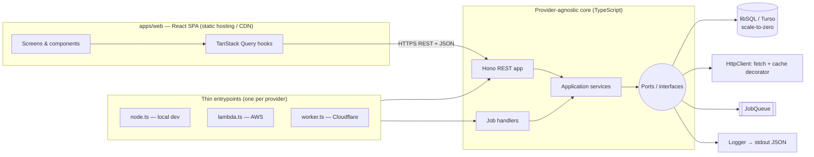
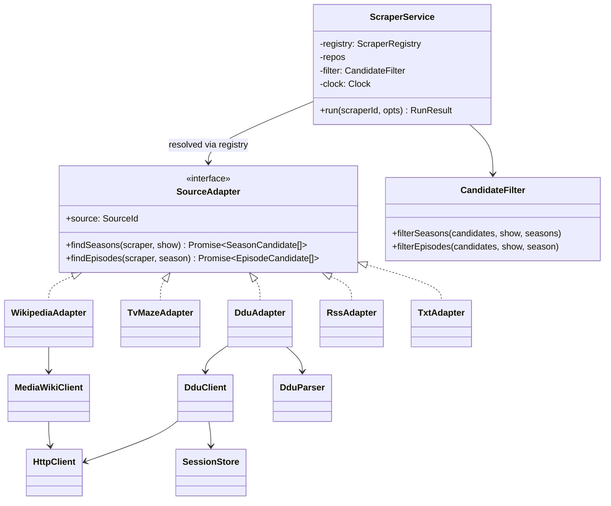
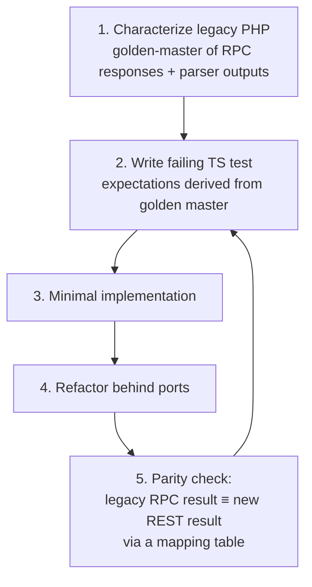

# TVScraper Migration Plan

**From:** PHP API + jQuery/Bootstrap 3 frontend, SQLite file, bash jobs
**To:** Node.js (TypeScript) + React, TDD-first, interface-based design with dependency injection, serverless and scale-to-zero, cloud-agnostic

## 0. Decisions

| # | Topic | Decision |
|---|---|---|
| 1 | Cloud target | **Kept open.** The code must run unchanged on AWS Lambda, Cloudflare Workers or plain Node. Provider-specific code is limited to thin entrypoints and adapters. |
| 2 | Infrastructure | **Must scale to zero.** No always-on servers, containers or provisioned databases. |
| 3 | Dead sources | **TVRage and TV Underground are dropped.** Their scrapers are not ported, and existing DB rows for them are removed during data migration. DDU, Wikipedia, TVMaze, RSS and TXT are ported. |
| 4 | API style | **REST.** The `action=` RPC endpoint is not carried over (see §6 for the transition). |
| 5 | Auth | **Single user.** |

---

## 1. Current state

| Area | Today | Implication |
|---|---|---|
| API | `api.php`: a single RPC endpoint (`POST action=…`) with about 35 methods, most of them passing straight through to the DB class. `runScraper` instantiates scrapers through a `switch` with `new`. | The method table defines the feature scope. The `switch` becomes a registry. |
| Persistence | `TVShowScraperDBSQLite.php` is the current backend. `TVShowScraperDB.php` is the legacy XML backend, still used by `TVScraper.php` and `migrate.php`. Core logic sits in **SQL views** that use `strftime('now')` (`bestScrapersFiles`, `tvShowsWithStats`, `seasonStats*`). | The XML backend is dropped. Time-dependent logic must take an injected clock. |
| Scrapers | `abstract TVShowScraper` with 7 subclasses. `TVU extends RSS`. Each subclass calls `new SimpleBrowser()` / `new DDUBrowser()` / `new DDUParser()` internally. | This is the main refactoring target: inheritance and hidden `new` calls are replaced by injected interfaces. |
| HTTP | `SimpleBrowser` keeps its config in **static** globals and stores cache and cookies on the **filesystem**. `DDUBrowser extends SimpleBrowser` and adds login. `MyCurl` shells out to `curl`. | Static config and local disk both break serverless and make testing hard. |
| Cross-cutting | `setLogger`/`log`/`error` is copy-pasted into about 8 classes. Errors are returned as `FALSE`. | One injected `Logger` and typed errors replace them. |
| Concurrency | `flock` on a file. | DB transactions replace it. |
| Frontend | `index.html` plus jQuery "classes" (`TVShow.js`, `Season.js`, `Scraper.js`, …) that clone DOM skeletons. | Rewritten in React. |
| Jobs / CLI | `tvjobs` / `tvshell` are bash scripts that call the HTTP API. | Replaced by scheduled functions and a Node CLI. |
| Auth | Delegated to web-server HTTP digest auth. | The app needs its own auth. |
| Tests | None. | Characterization tests come first. |

---

## 2. Target architecture



### Scale-to-zero stack (provider-agnostic)

| Concern | Choice | Why |
|---|---|---|
| Compute | Functions: Lambda **or** Workers **or** Node | All bill per request and scale to zero. Hono runs on all three. |
| Database | **libSQL (Turso)** via `@libsql/client` + Drizzle ORM | Serverless, scales to zero, reached over HTTP so it works from Lambda and Workers. It keeps the **SQLite dialect**, so the existing schema and views port with minimal change. Local dev and tests use an in-memory or file libSQL, the same engine as production, which keeps the TDD loop fast. Neon Postgres is the fallback if needed; repositories hide the choice. |
| HTTP cache & DDU session | A `kv` table in the same DB (`key`, `value`, `expiresAt`) behind the `Cache` / `SessionStore` ports | Adds no extra service and scales to zero. It can be swapped later for Upstash Redis or Cloudflare KV. |
| Job fan-out | `JobQueue` port. Adapters: SQS (AWS), Cloudflare Queues, in-process (local/tests) | Both cloud queues scale to zero. |
| Scheduling | EventBridge Scheduler / Cloudflare Cron Triggers, both calling the same `scheduled` handler | Configured per provider; the handler code is shared. |
| Frontend hosting | Any static host (S3 + CloudFront, Cloudflare Pages, …) | Static hosting has no idle cost. |
| Secrets & config | Env vars validated with zod in one `loadConfig()` | Works with every provider's secret mechanism. |
| Logs | pino JSON to stdout | Every provider collects stdout. |

### Monorepo layout (pnpm workspaces)

```
packages/
  domain/      pure TS: entities, best-file selection, season/episode rules — no I/O
  scrapers/    SourceAdapters + pure parsers (Wikipedia, TVMaze, DDU, RSS, TXT)
  ports/       interfaces only
  adapters/    implementations: fetch HttpClient, Drizzle repos, KV cache, queues
  contracts/   zod schemas + OpenAPI for the REST API (shared by api, web, cli)
apps/
  api/         Hono app, services wiring (composition root), entrypoints/{node,lambda,worker}.ts
  web/         React + Vite
  cli/         replaces tvshell / tvjobs (talks REST)
legacy/        current PHP, kept read-only as the reference until cut-over
doc/
```

---

## 3. Refactoring: subclasses → interfaces + dependency injection

### Ports

```ts
interface HttpClient    { get(url: string, opts?: { useCache?: boolean }): Promise<string>;
                          post(url: string, form: Record<string, string>): Promise<string>; }
interface Cache         { get(key: string): Promise<string | null>;
                          set(key: string, value: string, ttlSec: number): Promise<void>; }
interface SessionStore  { load(name: string): Promise<CookieJar>; save(name: string, jar: CookieJar): Promise<void>; }
interface JobQueue      { enqueue(job: Job): Promise<void>; }
interface Clock         { now(): Date; }
interface Logger        { debug(msg: string, ctx?: object): void; info(...): void; error(...): void; }

interface ShowRepository, SeasonRepository, EpisodeRepository,
          FileRepository, ScraperRepository, ScrapedSeasonRepository
```

### Scrapers: composition instead of inheritance



Rules:

1. **The base class's workflow becomes a service.** `runScraper`, `submitSeasonCandidates` and `submitEpisodeCandidates` move into `ScraperService` + `CandidateFilter`. Adapters only *fetch and parse*. They never touch the DB, so the `$showOnlyNew` / `$saveResults` flags no longer go through every adapter.
2. **Parsers are pure functions**, for example `parseDduTopicList(html, baseUrl)`, `parseWikipediaEpisodes(wikitext)` and `parseTvMazeEpisodes(json)`. They are the easiest code to test and the most fragile.
3. **`DDUBrowser extends SimpleBrowser` becomes a `DduClient` that wraps an `HttpClient`**, with the login flow and cookies persisted through `SessionStore`.
4. **Caching is a decorator**: `new CachingHttpClient(inner, cache, clock)`. No static flags remain.
5. **The `switch` becomes a `ScraperRegistry`** (`Map<SourceId, SourceAdapter>`), built in a **composition root** per entrypoint. DI is plain constructor injection with no framework, which keeps cold starts small.
6. **Time-dependent SQL views become repository queries that take `now`** from `Clock`. Best-file selection (`getBestFileForEpisode` + `bestScrapersFiles`) becomes a **pure domain function**, because it is the core business rule.
7. **Errors are typed** (`NotFoundError`, `ValidationError`, `SourceFetchError`, …) and mapped to HTTP status codes in a single place.
8. **One `Logger` is injected** instead of the copy-pasted `setLogger`/`log`.

---

## 4. REST API design

Resources replace the RPC methods of `api.php`. Request and response schemas live in `packages/contracts` (zod), and an OpenAPI document is generated from them.

| Legacy RPC method(s) | REST |
|---|---|
| `getAllTVShows`, `addTVShow` | `GET /shows` (with stats), `POST /shows` |
| `getTVShow`, `setTVShow`, `removeTVShow` | `GET / PATCH / DELETE /shows/{id}` |
| `getTVShowSeasons`, `addSeason` | `GET / POST /shows/{id}/seasons` |
| `getSeason`, `setSeason`, `removeSeason` | `GET / PATCH / DELETE /seasons/{id}` |
| `getAllWatchedSeasons` | `GET /seasons?status=watched` |
| `getSeasonEpisodes` | `GET /seasons/{id}/episodes` |
| `getEpisode`, `setEpisode`, `removeEpisode` | `GET / PATCH / DELETE /episodes/{id}` |
| `getFilesForEpisode` | `GET /episodes/{id}/files` |
| `getFile`, `setFile`, `removeFile` | `GET / PATCH / DELETE /files/{id}` |
| `getBestFileForEpisode` | `GET /episodes/{id}/best-file` |
| `getBestFilesForSeason` | `GET /seasons/{id}/best-files` |
| `TVScraper.php?action=latest`, `tvjobs get-best` | `GET /best-files?type=ed2k\|torrent&since=…&limit=…` |
| `tvjobs find-missing` | `GET /episodes?missing=true&airedBefore=…` |
| `getTVShowScrapers`, `addScraper` (show) | `GET / POST /shows/{id}/scrapers` |
| `getSeasonScrapers`, `addScraper` (season) | `GET / POST /seasons/{id}/scrapers` |
| `getScraper`, `setScraper`, `removeScraper` | `GET / PATCH / DELETE /scrapers/{id}` |
| `getActiveScrapers` | `GET /scrapers?active=true` |
| `runScraper` | `POST /scrapers/{id}/runs` (sync, single scraper) |
| `tvjobs update` | `POST /scraper-runs` (enqueues all active scrapers, returns `202`) |
| `getScrapedSeasons` | `GET /shows/{id}/scraped-seasons` |
| `getScrapedSeasonsTBN` | `GET /scraped-seasons?status=pending` |
| `setScrapedSeason`, `removeScrapedSeason` | `PATCH / DELETE /scraped-seasons/{id}` |
| `createSeasonScraperFromScraped` | `POST /scraped-seasons/{id}/accept` |
| *(auth)* | `POST /session`, `DELETE /session` |

**Semantics fix.** In the legacy code, `getBestFilesForSeason` and `getBestFileForEpisode` are flagged `save => TRUE`: a read has the side effect of updating the cached `bestFile`. In REST, `GET` must have no side effects. The best file is therefore recomputed **on write** (after a scraper run, or when a file is discarded or edited) inside the same transaction. `GET` stays a pure read.

Conventions: JSON only; `PATCH` takes partial bodies validated by zod; errors use RFC 9457 `application/problem+json`; ids are integers (preserving existing data); timestamps are ISO-8601 in the API and epoch seconds in the DB, as today.

---

## 5. Single-user auth

- One credential: `ADMIN_PASSWORD_HASH` (argon2/bcrypt) in env.
- `POST /session` with the password returns an **HttpOnly, Secure, SameSite=Strict** cookie holding a short-lived signed JWT (`SESSION_SECRET`). Being stateless, it needs no session store.
- The CLI and cron callers use a static **API token** (`API_TOKEN`) sent as `Authorization: Bearer …`.
- Hono middleware protects everything except `POST /session` and the health check.
- There are no user tables and no external identity provider. If multi-user is ever needed, the auth middleware is the only place that changes.

---

## 6. TDD strategy



Because the API moves from RPC to REST, parity is checked **at the service level**. The parity harness calls the legacy `action=X` and the equivalent REST route on the same seeded DB copy, normalizes both payloads, and diffs them. The table in §4 doubles as the harness's mapping.

| Layer | Tools | Scope |
|---|---|---|
| Domain (pure) | Vitest | best-file selection, complete-season cutoff, resolution check, ED2K and filename parsing (`TVShowUtils.php`) |
| Parsers | Vitest + **recorded fixtures** (`__fixtures__/*.html\|json`) | One fixture set per source, captured from real pages. Unit tests never hit the network. |
| Adapters | Vitest + in-memory fakes (`FakeHttpClient`, `MemorySessionStore`) | DDU login and re-login, pagination (`start=0..75`), error paths |
| Repositories | Vitest + in-memory libSQL + `FixedClock` | queries, cascades, the logic previously in views |
| API | Vitest + `app.request()` (Hono, no server needed) | every route: validation, auth, status codes, problem+json |
| Jobs | Vitest + `InMemoryJobQueue` | fan-out, retries, idempotency |
| Parity | Vitest suite against dockerized legacy PHP | §4 mapping on a copy of real data |
| Frontend | Vitest + Testing Library + MSW (handlers generated from contracts) | components, hooks, forms |
| E2E | Playwright | add show → add scraper → run → accept scraped season → view best files |
| Live smoke (non-blocking, nightly) | Vitest tagged `@live` | detects upstream HTML changes early |

Rules: no production code without a failing test first; coverage gate of **≥ 90 %** on `domain` and `scrapers`, ≥ 80 % elsewhere; CI on every PR (GitHub Actions: lint, typecheck, test, build).

---

## 7. Phases

| # | Phase | Deliverables | Exit criteria |
|---|---|---|---|
| **0** | Safety net | Move PHP to `legacy/` with a Docker Compose setup to run it. Capture fixtures for Wikipedia, TVMaze, DDU, RSS and TXT. Golden-master tests (TS/Vitest, over HTTP) for each RPC method against a seeded copy of the SQLite DB. | Every in-scope RPC method has recorded expected output. |
| **1** | Foundation | Monorepo, TS strict, ESLint, Prettier, Vitest, CI. `ports`, `contracts` (zod + OpenAPI), `loadConfig()`. | CI green on the skeleton. |
| **2** | Domain + parsers | Port `TVShowUtils`, `CandidateFilter` and best-file selection, then each parser as a pure function. | Parser outputs match golden masters. |
| **3** | Persistence | Drizzle schema from `TVShowScraperDB.sql`. Repositories with `Clock`. `kv` table. **Data migration script**: existing SQLite → libSQL, removing `tvrage` / `tvu` scrapers together with their scraped seasons and files. | Repository tests green. Stats and best-file queries match the legacy views on real data. |
| **4** | Adapters + ScraperService | `FetchHttpClient`, `CachingHttpClient`, `KvCache`, `KvSessionStore`, `MediaWikiClient`, `DduClient`, the 5 adapters, registry, composition root. | `run` results match legacy on fixtures. DDU login verified live from a cloud function (egress IP check). |
| **5** | REST API + auth | Hono routes from §4, auth from §5, problem+json errors, OpenAPI document. Entrypoints `node.ts`, `lambda.ts`, `worker.ts`, each with a smoke test. | Parity suite green. The same app boots on all three entrypoints. |
| **6** | Jobs + CLI | `scheduled` handler (enqueue one job per active scraper), queue consumer (run a single scraper, idempotent), `notify` and `cleanup` jobs. `apps/cli` (`tvscraper update \| get-best \| find-missing \| …`) over REST with `API_TOKEN`. | A nightly run in staging matches the bash `tvjobs` output. |
| **7** | React frontend | Vite + React + TanStack Query + React Router + a component library (Mantine or shadcn/ui). API client generated from contracts. Screens: login → shows list with stats → show detail (seasons, scrapers, scraped seasons) → season detail (episodes, files, best file) → edit dialogs. | Feature-parity checklist done. Playwright E2E green. |
| **8** | Deploy + cut-over | IaC for the chosen provider (SST for AWS **or** Wrangler for Cloudflare; the code is the same either way). Production data migration. Retire PHP and delete `legacy/`. | Production running with zero idle cost. Legacy removed. |

Phases 2–4 can overlap. Phase 7 can start once the contracts from phase 5 are frozen, using MSW mocks.

**Transition.** Because the API is now REST, the old jQuery UI cannot be pointed at the new backend. PHP keeps serving the old UI and RPC until the React app reaches parity (end of phase 7), then everything switches at once. The parity suite is the safety net for that switch.

---

## 8. Serverless checklist (applies to every handler)

- Stateless: no local disk, no module-level mutable state beyond lazily-created clients.
- All dependencies built in the composition root from `loadConfig()`. No global singletons or static config.
- Each scraper run fits comfortably within the shortest provider limit. DDU pagination can be split into one job per page if needed.
- Jobs are idempotent: a retried message must not create duplicate files or episodes (enforced with unique constraints and upserts).
- Bundles are small and start fast (esbuild; no heavy DI or ORM runtime reflection).
- Only Web-standard APIs in the core (`fetch`, `Request`/`Response`, `crypto.subtle`), so it runs on both Node and Workers. HTML parsing uses a library that works in both (e.g. `linkedom` or `htmlparser2`).

---

## 9. Risks

| Risk | Mitigation |
|---|---|
| Upstream HTML changes break parsers | Versioned fixtures and a nightly `@live` smoke run |
| DDU blocks or rate-limits cloud egress IPs | Verify early in phase 4. Respect cache TTL. Fall back to running DDU jobs from the local Node entrypoint if needed. |
| Logic split between SQL views and PHP is lost in the port | Parity tests on a real data copy with a fixed clock |
| Scope creep in the React rewrite | Strict parity first, improvements tracked separately after cut-over |
| Cold start on scale-to-zero (DB + function) | Acceptable for a single user. Keep bundles small and use the HTTP DB driver. |
